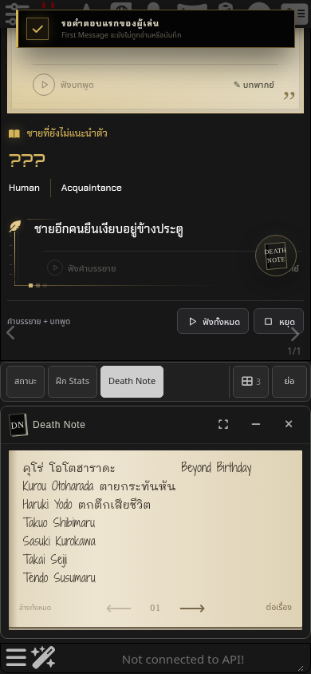
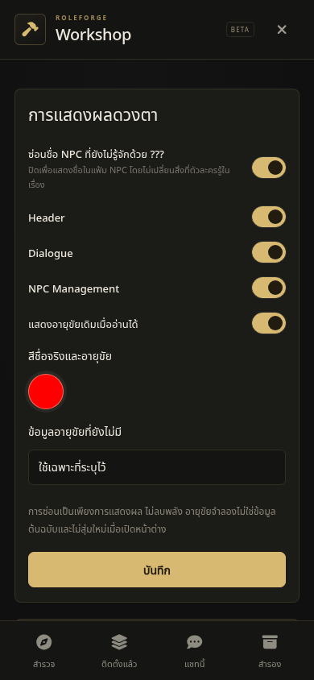

# Death Note 0.83.1 — ปุ่มลอย ชื่อ NPC และสมุดบนมือถือ

ติดตั้ง SillyTavern 1.19.0 ใน `/workspace/SillyTavern` และเชื่อม RoleForge จาก `/workspace/rpg-systems` เพื่อทดสอบผ่านหน้าแชทจริง

## สิ่งที่แก้ไข

| รายการ | ผลหลังแก้ |
| --- | --- |
| ปิดปุ่ม Draggable | Workshop → แชทนี้ → Death Note → **ปุ่มลอย Death Note ที่ลากได้** สวิตช์นี้บันทึกแยกตามแชท และยังเปิดสมุดจาก Chatbar/Wand Menu ได้ |
| การลากช้า | ย้ายด้วย `translate3d` ตาม `requestAnimationFrame` อ่านขอบเขตตอนเริ่มลาก ลดการอ่าน/เขียน layout ระหว่างเคลื่อนไหว และไม่ให้การ sync ตั้งค่าดึงตำแหน่งกลับระหว่างลาก |
| ชื่อ NPC `???` | Workshop → แชทนี้ → Death Note → ตั้งค่า → **ซ่อนชื่อ NPC ที่ยังไม่รู้จักด้วย ???** เปิดเป็นค่าเริ่มต้น ปิดแล้วแสดงชื่อแฟ้ม NPC และเปิดกลับได้ |
| Adventurer ในผู้มีดวงตา | ตัวเลือกผู้เล่นอ่านชื่อ Persona ปัจจุบันจาก SillyTavern ส่วนรหัสภายในยังเป็น `player` เพื่อให้สิทธิ์สมุด/พลังเดิมอ้างอิงได้ |
| สมุดเบี้ยวก่อนแตะครั้งแรก | วัดกล่องข้อความใหม่เมื่อกระดาษปรากฏ เปลี่ยนขนาด หรือฟอนต์โหลดเสร็จ โดยคงข้อความและตำแหน่งที่กำลังแก้ไขไว้ |
| เลข `01` ชิดลูกศร | จัดกลางด้วย grid เว้นระยะ 10px เท่ากันทั้งสองด้าน ปุ่มลูกศรมีพื้นที่กด 44×44 และใช้ทั้งสมุดเต็มหน้า/เหนือ Chatbar |
| ตัวเลือกสีวงรีบน Safari | ใช้ตัวอย่างสีวงกลม 44×44 แสดงสีที่เลือกทันที ยังเปิด native color picker และบันทึกสีเดิมได้ |

การเปิดเผยชื่อใน UI ไม่เพิ่มข้อมูล `claims` หรือความรู้ใน prompt ของตัวละคร ไม่เปลี่ยนชื่อจริงในแฟ้ม และไม่มอบพลังดวงตา/ความทรงจำใบหน้า

## สาเหตุของสมุดผิดรูป

แผงสมุดถูกสร้างตอน Chatbar ยังพับอยู่หรือเลือกแผงอื่น กระดาษจึงมีความกว้างเป็นศูนย์ โค้ดเดิมใช้ค่าขั้นต่ำ `60px` วัดข้อความ ทำให้ชื่อภาษาไทย/อังกฤษตัดบรรทัดมากเกินไป และกล่องข้อความที่ใช้ตำแหน่งสัดส่วนซ้อนกัน เมื่อแตะสมุดแล้วโค้ดวัดใหม่จึงกลับมาเป็นปกติ

เพิ่ม `ResizeObserver` ให้กระดาษ และติดตาม `document.fonts.ready` / `loadingdone` เพื่อจัดตำแหน่งใหม่โดยอัตโนมัติ พร้อมถอด observer/listener เมื่อปิด editor

## Theme ที่ใช้

ใช้ `1-Dark-Lite.json` ที่ผู้ใช้แนบมา โดยติดตั้งเป็น Dark Lite ใน SillyTavern ทดสอบยืนยันค่า Custom CSS, Reduced Motion, Fast UI และ Chat width ตรงกับไฟล์จริง ค่า SHA-256 ของไฟล์:

`beaa954c59ed1466e8d9dd47f88feee8692b02790ff4d69e0e682b8e22f31541`

ไฟล์นี้มี CSS ขยายแชทเต็มความกว้าง และเปิด Reduced Motion ภาพผลล่าสุดจึงใช้พื้นที่ตาม Theme ของผู้ใช้

## การตรวจสอบ

- Unit/integration tests ผ่าน **1,709/1,709** และ `npm run check` ผ่าน
- Chromium บน PC 1440×1120 และมือถือ 390×844: ผ่านการเปิดสมุดครั้งแรก พับ/สลับแผง เปลี่ยนขนาด/แนวหน้าจอ รักษา draft เปิดปิดสวิตช์ บันทึก/รีโหลด และเมาส์/สัมผัส
- จุดตรวจการลาก 20, 50, 90px: คลาดเคลื่อน **0px** หลังรอหนึ่งเฟรมในทั้งสอง viewport
- เลขหน้า: ห่างจากกล่องปุ่มซ้าย/ขวา **10px เท่ากัน** ทั้ง dock และ fullscreen
- ตัวเลือกสี: **44×44, border-radius 50%** กดถึง native input และบันทึกสีใหม่ได้
- WebKit 26.5 บน PC/มือถือ: ผ่านชุด controls เดียวกัน รวมวงกลมสี การบันทึกสี การรีโหลด และระยะเลขหน้า
- ชุดเดิมครอบคลุม RoleForge, Folio, Chapter, Codex และ Aincrad ทั้งเปิด/ปิด Header และ Voice ผ่านรวม 40 ชุดเงื่อนไขบน PC/มือถือ รวมสิทธิ์สมุด การแลกดวงตา และ native Branch
- Native Continue: ปิดสมุดระหว่างรอ AI ได้ทั้ง PC/มือถือ รวมคำตอบล่าช้า ข้อผิดพลาดที่ควบคุมไว้ และการคงข้อความที่ยังไม่ส่ง
- ทำซ้ำอาการเดิมโดยคืนเฉพาะ `paper-editor.js` จาก commit `69af928`: กล่องข้อความเหลือ 60px ทั้งสอง viewport ภายใต้ Theme เดียวกัน หลังแก้กล่องข้อความแรกกว้างประมาณ 200px และข้อความไม่ซ้อนเมื่อเปิดแผง
- ปรับ browser test ให้จับ computed style ของ element ที่ยังอยู่ใน DOM ใน snapshot เดียว เพื่อไม่อ่านค่าว่างจาก element เก่าระหว่างแชทวาดใหม่

[ผลรวม](validation/death-note-v0.83.1/summary.json) · [ธีม/ดวงตา/สิทธิ์/Branch](validation/death-note-v0.83.1/actors.json) · [ผลตรวจ Chromium](validation/death-note-v0.83.1/controls-chromium.json) · [WebKit](validation/death-note-v0.83.1/controls-webkit.json) · [ปิดระหว่าง AI ทำงาน](validation/death-note-v0.83.1/close.json) · [จำลอง editor ก่อนแก้](validation/death-note-v0.83.1/baseline.json)

## Screenshot — Theme ที่ผู้ใช้แนบ

| ภาพ | PC | มือถือ |
| --- | --- | --- |
| สมุดเมื่อเปิดครั้งแรกและระยะเลขหน้า | [เปิดภาพ](previews/death-note-v0831/desktop-notebook-first-open.png) | [เปิดภาพ](previews/death-note-v0831/mobile-notebook-first-open.png) |
| ตัวเลือกสีวงกลม | [เปิดภาพ](previews/death-note-v0831/desktop-round-color-picker.png) | [เปิดภาพ](previews/death-note-v0831/mobile-round-color-picker.png) |

[WebKit: สมุดมือถือ](previews/death-note-v0831/webkit-mobile-notebook.png) · [WebKit: สีวงกลม](previews/death-note-v0831/webkit-mobile-color.png) · [อาการเดิมจาก editor ก่อนแก้](previews/death-note-v0831/baseline-mobile-notebook.png)

[Persona แทน Adventurer](previews/death-note-v0831/mobile-persona-settings.png) · [สวิตช์ปุ่มลอย](previews/death-note-v0831/mobile-floating-off.png) · [ซ่อนชื่อ](previews/death-note-v0831/mobile-names-masked.png) · [แสดงชื่อ](previews/death-note-v0831/mobile-names-visible.png)





คำสั่งทดสอบ:

```sh
npm test
npm run check
ST_REAL_URL=http://127.0.0.1:18186 ST_THEME_FILE=/path/to/1-Dark-Lite.json npm run test:death-note:controls:real
ST_REAL_URL=http://127.0.0.1:18186 npm run test:death-note:actors:real
ST_REAL_URL=http://127.0.0.1:18186 npm run test:death-note:close:real
```

ให้ติดตั้ง Theme ใน SillyTavern ก่อนใช้ `ST_THEME_FILE` ซึ่งใช้ตรวจยืนยันไฟล์กับการตั้งค่าที่โหลดจริง ตั้ง `DN_BROWSER=webkit` เพื่อรันชุด controls ด้วย WebKit; Chromium ทดสอบการลากแบบสัมผัสผ่าน CDP และ WebKit ทดสอบการแตะกับการลากด้วย pointer ใน viewport มือถือ

การทดสอบ browser ใช้ Playwright กับ SillyTavern จริง ข้อมูลตัวละครและคำตอบ AI เป็น fixture ที่ควบคุมได้ ไม่เรียกโมเดลหรือบริการเสียงภายนอก การทดสอบมือถือเป็น viewport/touch emulation ไม่ใช่การทดสอบบน iPhone เครื่องจริง

อัปเดตเป็น 0.83.1 และเปลี่ยน query version ของ runtime/CSS เพื่อให้การติดตั้งเดิมโหลดไฟล์ที่แก้แล้ว หลังอัปเดตให้โหลดหน้า SillyTavern ใหม่
