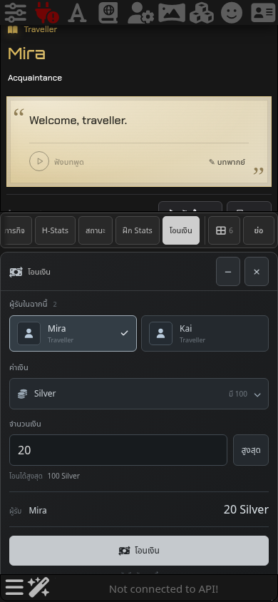
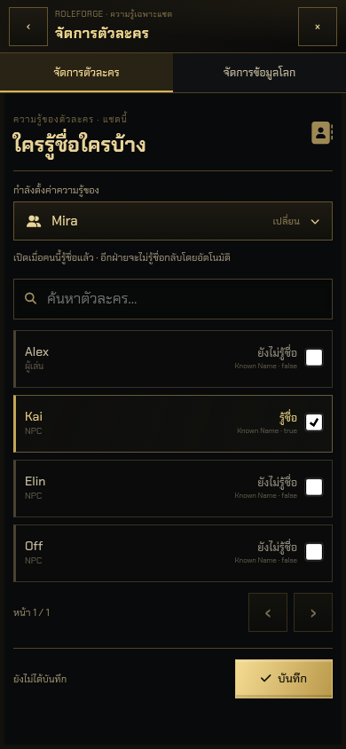

# RoleForge 0.78.0 — โอนเงินและ Known Names

โอนเงินได้จาก **กระเป๋า → โอนเงินให้ NPC** หรือ **สถานะ → โอนเงิน** เหนือ chatbar ส่วน Known Names อยู่ใน **NPC Management** ใช้กรอบ สี และปุ่มของหน้าจัดการเดิม ไม่มีหน้าต่างจัดการแยกอีกชั้น

## โอนเงิน

1. เปิดกระเป๋าหรือสถานะเหนือ chatbar แล้วกด **โอนเงิน**
2. เลือก NPC ที่เปิดใช้งานและอยู่ในฉากปัจจุบัน
3. แตะหน่วยเงินหากต้องการเปลี่ยน หน่วยจำนวนมากค้นหาและแบ่งหน้าได้โดยไม่เปิด native select ของ iOS
4. ใส่จำนวนเต็มบวก หรือกด **สูงสุด** ตรวจผู้รับและจำนวน แล้วกด **โอนเงิน**
5. หน้าสำเร็จแสดงผู้รับ จำนวน และสถานที่ รายการบันทึกกับแชตนี้

ใช้หน่วยและอัตราแลกที่โลกตั้งไว้ ทอนเงินได้ และไม่นำเงินที่กันไว้สำหรับรายการอื่นไปใช้ ป้องกันการกดซ้ำระหว่างบันทึก คำขอเดิมที่สำเร็จแล้วจะไม่หักซ้ำ

การโอนไม่ส่งข้อความ User ไม่แก้ร่างในช่องพิมพ์ และไม่เรียกโมเดล ผู้รับถูกบันทึกว่าได้รับเงินผ่านใบรับรายการ ระบบไม่สร้างยอดทรัพย์สินทั้งหมดของ NPC ขึ้นมาเอง และไม่เพิ่มความสัมพันธ์หรือความรู้เรื่องชื่อจากการรับเงิน คำสั่งที่ส่งให้โมเดลในเทิร์นถัดไปจะระบุว่าเงินจำนวนนี้ถูกโอนไปแล้ว

## Known Names ใน NPC Management

เข้าผ่าน **NPC Management → ความรู้เรื่องชื่อ** หรือเปิดรายละเอียด NPC แล้วกด **ความรู้เรื่องชื่อ** จากนั้น:

1. เลือกเจ้าของความรู้ที่ต้องการตั้งค่า เป็นผู้เล่นหรือ NPC ก็ได้
2. เปิดหรือปิดชื่อของแต่ละคน แล้วกด **บันทึก**
3. เปลี่ยนเจ้าของความรู้เพื่อตั้งอีกทิศทาง การบันทึกใช้เฉพาะแชตปัจจุบัน

ตัวอย่าง เลือก **Mira** แล้วเปิด **Kai** หมายถึง Mira รู้ชื่อ Kai เท่านั้น Kai ยังไม่รู้ชื่อ Mira จนกว่าจะมีการแนะนำตัวหรือผู้ใช้ตั้งค่าให้เขา การรู้ชื่อผู้เล่นก็แยกเป็นอีกช่องหนึ่ง

`knownNames` เป็น map ตาม ID ของบุคคลที่ถูกกล่าวถึง เก็บบน `player` และ NPC แต่ละคน ตัวอย่าง `npc.knownNames = {player: false, kai: true}` ผู้สร้างการ์ดสามารถกำหนดค่าเริ่มต้นผ่านข้อมูล NPC หรือ `initialState.player.knownNames` ได้ ค่าที่ไม่มีถือเป็น false รวมถึงแชตเก่าที่ไม่เคยบันทึกความรู้เรื่องชื่อ การรู้ชื่อตัวเองเป็นข้อยกเว้น

ชื่อในแฟ้มข้อมูล รูป Header การเคยพบ (`met`) การเปิดตัวละคร (`enabled`) การอยู่กลุ่มเดียวกัน หรือการรับเงิน ไม่ใช่หลักฐานว่ารู้ชื่อ ระบบรับการแนะนำตัวตรง ๆ ภาษาไทย/อังกฤษ และเหตุการณ์เปิดเผยชื่อที่มีคำอ้างอิงตรงกับข้อความจริงเฉพาะผู้ฟังในฉาก ไม่ยอมรับเพียงคำทักที่ AI เผลอใส่ชื่อ และไม่ยอมให้ AI แก้ `knownNames` ผ่าน NPC upsert

เมื่อเปิดการติดตามคำตอบ AI ระบบจะบันทึกการเรียนรู้ชื่อจากเหตุการณ์ที่ตรวจได้ การป้องกันใน prompt ทำงานร่วมกับตัวกรองชื่อในบทพูดของ RoleForge ทั้งแบบ Original และ Shared รวมถึงบทพากย์ที่ตกแต่งผ่าน RoleForge ตัวกรองรองรับการเรียกชื่อไทยติดกับคำว่า “คุณ” และคำลงท้าย “ครับ” ด้วย ประวัติแต่ละคำตอบใช้ความรู้ใน checkpoint ของข้อความนั้น การเรียนรู้ชื่อภายหลังจึงไม่ทำให้คำทักที่ผิดในอดีตกลับมาเผยชื่อ

การตั้งค่า Known Names ด้วยมือจะเก็บ map ไปยัง checkpoint เดิม โดยไม่คัดลอกหรือย้อนทับประวัติและ Stats ของ NPC ทั้งตัว ผู้ใช้ยังเปิดรายชื่อตัวละครและเห็นชื่อจริงในเครื่องมือจัดการได้ เพราะเป็นหน้าสำหรับผู้จัดเนื้อเรื่อง

[ดูหน้าโอนเงินบนคอม](previews/money-known-names-v0.78.0/desktop-transfer.png) · [ดู NPC Management บนคอม](previews/money-known-names-v0.78.0/desktop-known-names.png)

## ผลทดสอบและขอบเขต

- Unit/host integration: `npm test` รวมทดสอบยอดเงิน การทอน เงินกันไว้ กดซ้ำ บันทึกที่ reject ความรู้ทุกทิศทาง การป้องกันชื่อ และการรักษา checkpoint ดูจำนวนและผลสุดท้ายใน [รายงานตรวจสอบ](validation-money-known-names-v0.78.0.json)
- SillyTavern จริง: 1.19.0, revision `06bde939fb1e9c4c8d8641d810f0a916b5bce127`, Chromium บน desktop และ mobile/touch emulation ธีม Dark Lite นำเข้าการ์ดผ่าน API ของ SillyTavern แล้วใช้หน้าจริง ทดสอบเงิน 8 หน่วย การบันทึก/reload ฉาก ผู้รับ เปลี่ยนการ์ด และ Known Names ภายใน NPC Management
- การตอบ AI ในการทดสอบใช้ streaming fixture ที่ควบคุมผล ผ่าน Generate/StreamingProcessor จริงของ SillyTavern รวม 4 คำขอ ไม่มีการเรียกผู้ให้บริการโมเดลหรือเสียงที่เสียเงิน การโอนเองสร้างคำขอโมเดล 0 ครั้ง
- Browser regression: Regex Shared/Native, Voice, การแก้ข้อความในแชต 200 ข้อความ, dock และ Stats/Currency ตรวจแยกจากการรัน SillyTavern ทั้งแอป

ยังไม่ได้ทดสอบบน iPhone หรือ Safari จริง ตัวกรองชื่อทำงานกับบทพูดที่ RoleForge แยกได้และเสียงที่ผ่าน RoleForge; native mode และ widget จากส่วนเสริมอื่นที่ครอบทั้งข้อความรักษาหน้าตาเดิมไว้ ข้อความต้นฉบับและบรรยายไม่ถูกแก้เขียนทับ การใช้ชื่อในคำตอบโมเดลนอกส่วนที่แยกได้ยังขึ้นกับการปฏิบัติตาม prompt ของโมเดล

ทดสอบ rollback ของการบันทึกด้วย host mock ที่ reject และทดสอบ save/reload ปกติใน SillyTavern จริง เวอร์ชัน SillyTavern ที่ทดสอบอาจจับ HTTP save error ไว้ภายในโดยไม่ reject จึงยังไม่อ้างว่าตรวจจับ server save failure ได้ครบทุกกรณี
