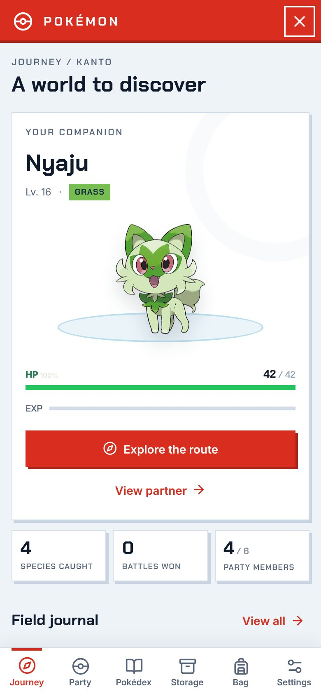
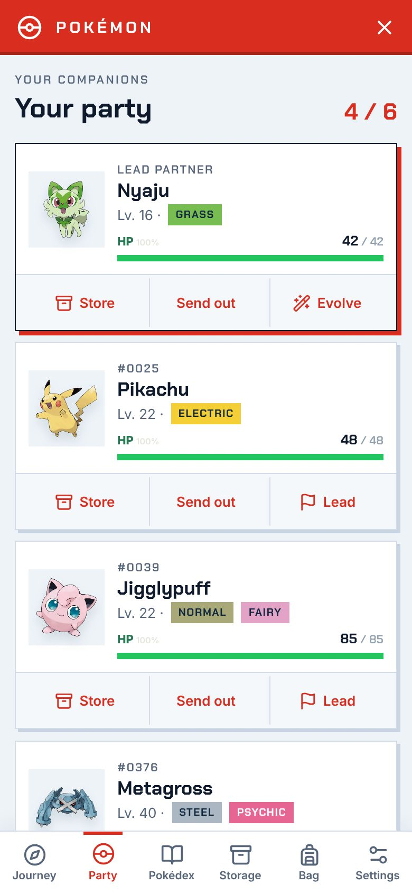
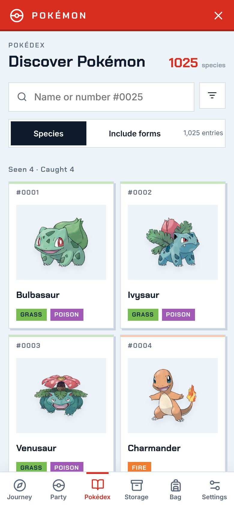
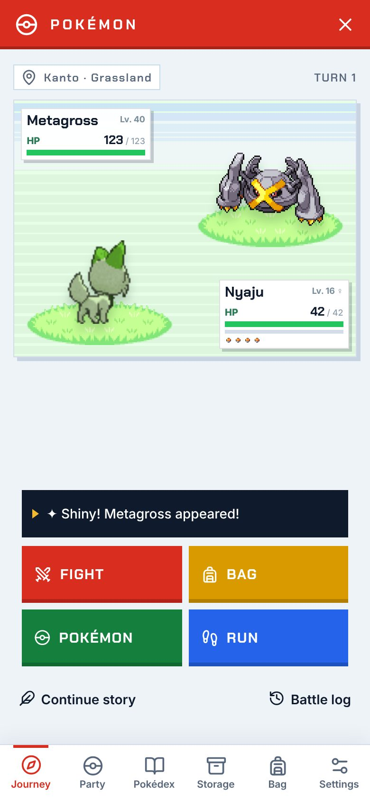
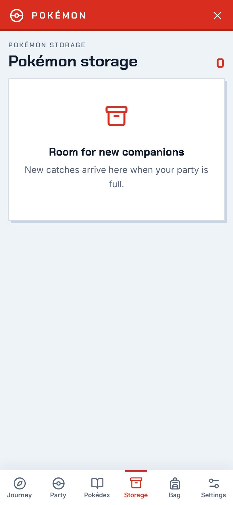
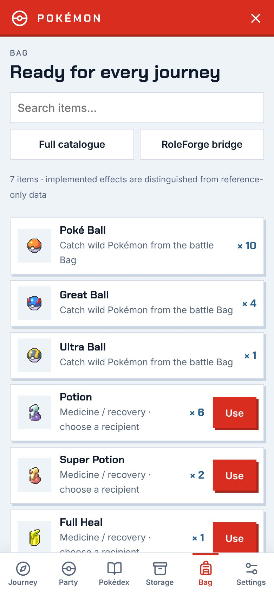
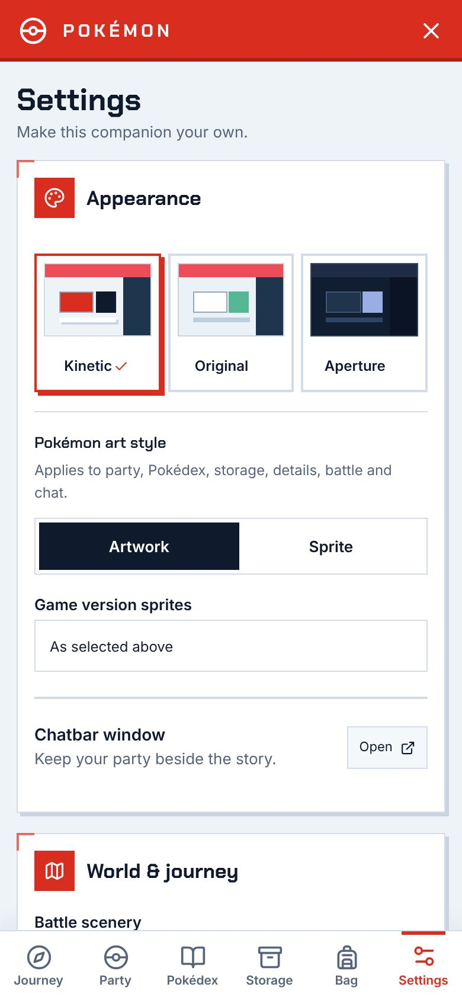
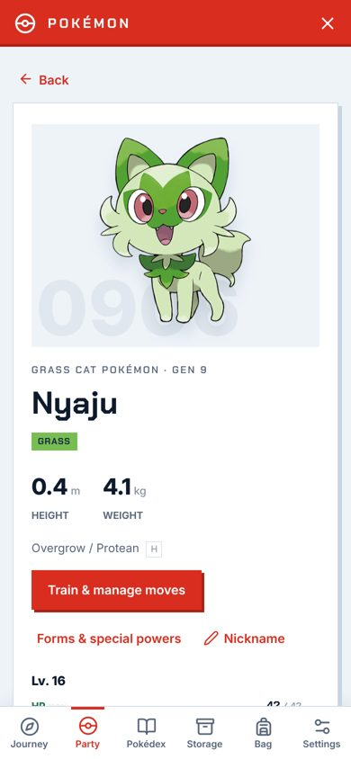

# Pokémon 1.9.0 / RoleForge 0.92.0 — Kinetic

หน้าตาใหม่ทั้งหมดของ Pokémon add-on ทุกหน้าจอใช้ธีม **Kinetic** เป็นค่าเริ่มต้น ธีม Original และ Aperture ยังเลือกได้ที่ Settings → Appearance

## หน้าตาใหม่

- **ภาษาภาพเดียวกันทุกหน้า:** Journey, Party, Pokédex, Storage, Bag, Settings, หน้ารายละเอียด, Services, Trainers, Sandbox, หน้าต่อสู้ และหน้าต่างเหนือ Chatbar ใช้แผงเรียบ เงาแข็งแบบเยื้อง สีแดงเป็นสีเน้นสีเดียว และตัวอักษร Chakra Petch (รองรับไทย ฝังมากับ add-on ไม่โหลดจากภายนอก)
- **ไอคอน Lucide:** แทนไอคอน Font Awesome เดิมทุกจุด รวมถึงสัญลักษณ์ Poké Ball แบบเส้น ใช้กับทุกธีม
- **การเคลื่อนไหว:** การ์ดค่อย ๆ เลื่อนขึ้นตามลำดับ ปุ่มยุบเมื่อกด ภาพโปเกมอนลอยเบา ๆ แท็บที่เลือกเด้งขึ้น ทั้งหมดปิดตามการตั้งค่า Animations และ Reduce motion ของระบบ
- **หน้าต่อสู้:** ปุ่ม Fight / Bag / Pokémon / Run เป็นแผงสีเต็มพร้อมไอคอน ป้าย HP เลื่อนเข้ามาจากด้านข้าง ท่าโจมตีมีแถบสีตามธาตุ

## มือถือ (iOS และ Android)

- แถบเมนูด้านล่าง 6 แท็บ ปุ่มสูง 58px และเว้นขอบตาม safe area ของ iPhone ที่มี Home indicator และ notch
- ปุ่มและช่องกรอกทุกตัวในหน้าจอหลักมีขนาดอย่างน้อย 44px ช่องกรอกใช้ตัวอักษร 16px จึงไม่ซูมเองบน iOS
- หน้าต่อสู้ใช้สนามสัดส่วน 4:3 และวางปุ่มคำสั่งไว้ล่างจอ กดด้วยนิ้วโป้งได้
- ทดสอบที่ความกว้าง 320, 360 และ 390px ไม่มีส่วนใดล้นจอแนวนอน แท็บเล็ตแนวตั้งใช้พื้นที่เต็มจอ

## รวมอยู่ในรุ่นนี้ด้วย

- ปาบอลเรียกโปเกมอนออก เก็บกลับ ตัวที่หมดสภาพหรือจับได้กลับเข้าบอล และเอฟเฟกต์ของท่าและสถานะ (หลับ อัมพาต ติดเสน่ห์ ฯลฯ)
- ขนาดโปเกมอนในฉากสู้คำนวณจากพิกเซลที่มองเห็นจริงและความสูงของสายพันธุ์ ตัวใหญ่อย่าง Giratina ในชุดภาพ HD จึงไม่เล็กเกินไป

## ภาพตัวอย่าง (SillyTavern จริง)

| มือถือ | | | |
|---|---|---|---|
|  |  |  |  |
|  |  |  |  |

เดสก์ท็อป: [Journey](previews/pokemon-0.92.0/desktop-adventure.jpg) · [Party](previews/pokemon-0.92.0/desktop-team.jpg) · [Pokédex](previews/pokemon-0.92.0/desktop-dex.jpg) · [Bag](previews/pokemon-0.92.0/desktop-bag.jpg) · [Settings](previews/pokemon-0.92.0/desktop-settings.jpg) · [Battle](previews/pokemon-0.92.0/desktop-battle.jpg) · [Dock](previews/pokemon-0.92.0/desktop-dock.jpg) · Android 360px: [Journey](previews/pokemon-0.92.0/android-adventure.jpg) · 320px: [Party](previews/pokemon-0.92.0/small-team.jpg) · แท็บเล็ต: [Pokédex](previews/pokemon-0.92.0/tablet-dex.jpg)

## การตรวจสอบ

- `npm test` ผ่าน 2,227 รายการ, `npm run check` และ `git diff --check` ผ่าน
- SillyTavern 1.19 จริง: ทุกหน้าที่ 1280×800, 820×1180, 390×844, 360×780 และ 320×640 ไม่มี error ในหน้าเว็บ ไม่มีองค์ประกอบล้นจอ และปุ่มบนมือถือทุกตัวสูงอย่างน้อย 40px
- ธีม Original และ Aperture แสดงผลเหมือนเดิม นอกจากไอคอนใหม่

ฟอนต์ Chakra Petch ใช้สัญญาอนุญาต SIL Open Font License 1.1 (`src/workshop/pokemon/fonts/OFL.txt`) ไอคอน Lucide ใช้สัญญาอนุญาต ISC
