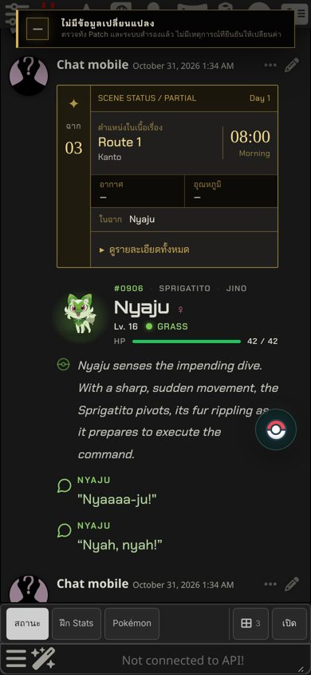
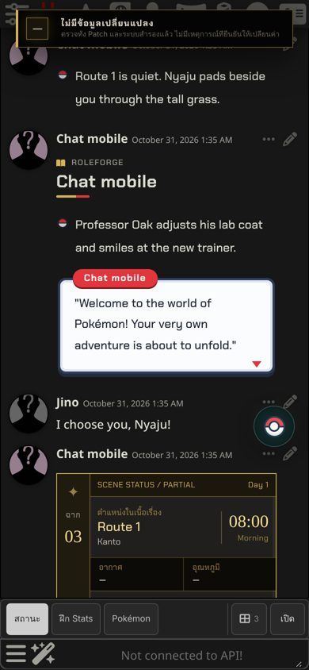
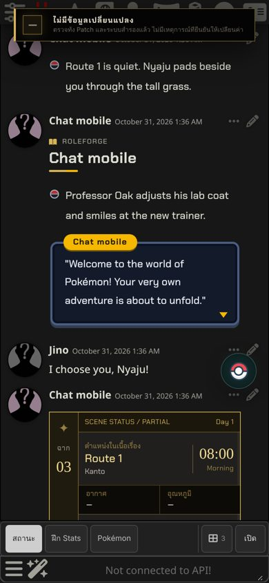
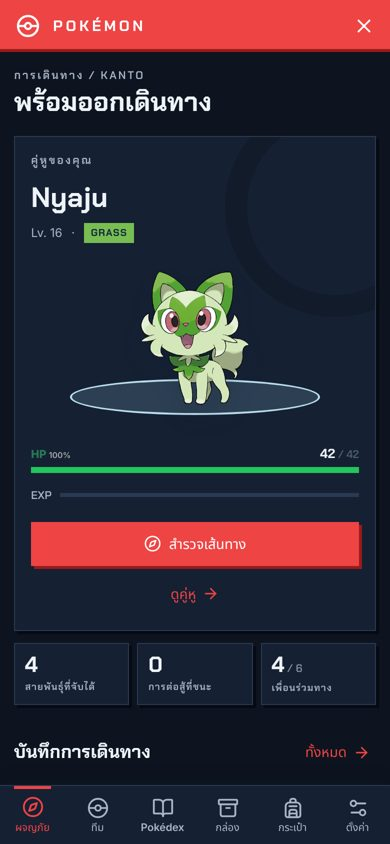
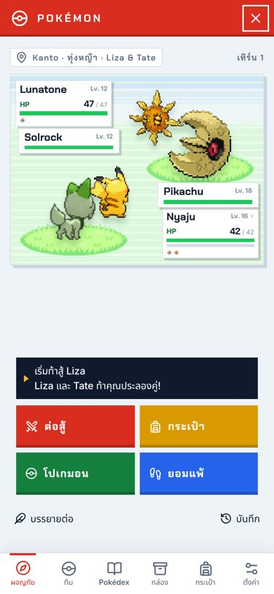
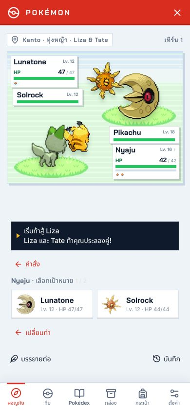
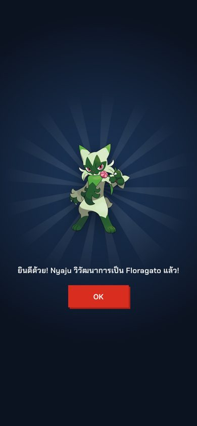
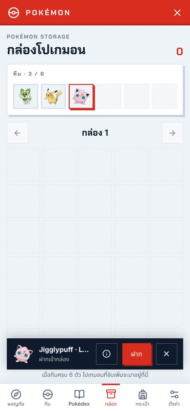

# Pokémon 2.0.0 / RoleForge 0.93.0

## แชทหลัก: Header โปเกมอนแบบไร้กรอบ

- **ไม่มีกรอบ ไม่มีพื้นหลัง:** Header คำบรรยาย และบทพูดของโปเกมอนกลมกลืนกับพื้นหลังของ SillyTavern ใช้สีตัวอักษรของธีม SillyTavern และใช้สีธาตุเป็นสีเน้นเพียงสีเดียว
- **Header:** ภาพโปเกมอนมีแสงสีธาตุอยู่ด้านหลัง ตามด้วยหมายเลข สายพันธุ์ เจ้าของ ชื่อ เพศ เลเวล ธาตุ สถานะ และแถบ HP แบบบาง ตัว Shiny มีประกาย ✦ ตัวที่หมดสภาพเป็นภาพขาวดำ
- **บทพูด:** ข้อความที่ผู้เขียนใส่เครื่องหมายคำพูดไว้แล้วจะไม่มีเครื่องหมายซ้อนสองชั้นอีก
- **ฟอนต์ชื่อ:** ใช้ฟอนต์ชื่อของธีม RoleForge ที่เลือก เหมือนตัวละครอื่นในแชท
- **ข้อมูลฉาก:** ช่อง "ในฉาก" แสดงชื่อโปเกมอนแทนรหัส `pokemon:…`

## ธีมแชทใหม่: Pokémon League · Day และ · Night

เลือกได้ที่ RoleForge → Chat appearance → Theme มีผลกับทุกตัวละคร

- **Day:** ป้ายชื่อแบบบัตรเทรนเนอร์ กรอบภาพวงกลมสีแบบ Poké Ball กล่องข้อความสีขาวแบบในเกม ป้ายชื่อสีแดง และลูกศร ▼ กะพริบ
- **Night:** เลย์เอาต์เดียวกันในโหมดมืด กล่องข้อความสีกรมท่า ป้ายชื่อและลูกศรสีทอง
- คำบรรยายไม่มีกรอบ ใช้จุด Poké Ball นำหน้า โปเกมอนยังใช้ Header แบบไร้กรอบในทั้งสองธีม

## หน้าต่าง Pokémon

- **โหมดมืดของ Kinetic:** Settings → Appearance → Colour mode เลือกได้ อัตโนมัติ / สว่าง / มืด (อัตโนมัติจะตามการตั้งค่าของอุปกรณ์)
- **ประลองคู่ (Double battle):** เมื่อเทรนเนอร์สองคนท้าพร้อมกันในโรล (AI ใส่ `"partner"` ให้ทั้งสองคน) จะเริ่มศึก 2 ต่อ 2 โปเกมอนสองตัวแรกที่ยังสู้ได้ของคุณเจอกับโปเกมอนของเทรนเนอร์แต่ละคน กดต่อสู้แล้วเลือกท่าและเป้าหมายให้ทีละตัว ทั้งสี่ตัวลงมือตาม Priority และ Speed ตัวที่หมดสภาพจะถูกแทนด้วยตัวถัดไปของเจ้าของ ชนะได้เมื่อทีมของทั้งสองคนหมด ท่าโจมตีหลายเป้าหมายยังนับเป็นเป้าหมายเดียว
- **จับโปเกมอน:** บอลส่ายช้า ๆ 1-2-3 ครั้ง แล้วคลิกจับได้ หรือแตกออกพร้อมข้อความแบบในเกม
- **วิวัฒนาการ:** ร่างเดิมเรืองแสงขาว สลับกับเงาร่างใหม่เร็วขึ้นเรื่อย ๆ แล้วแสงวาบเผยร่างใหม่
- **กระเป๋า:** แบ่งช่อง ยา / บอล / ของถือและแปลงร่าง / แผ่นท่า / อื่น ๆ
- **กล่อง:** ตารางกล่องละ 30 ช่องพร้อมแถบทีมด้านบน แตะเพื่อหยิบ แล้วกด ฝาก / ถอน / ดูข้อมูล จากแถบด้านล่าง
- **ชุดทีม:** บันทึกทีมปัจจุบันเป็นชุด (สูงสุด 6 ชุด) แล้วสลับกลับได้ในคลิกเดียว บันทึกอยู่ในแชทจึงตาม swipe และ branch
- **ความคืบหน้า Pokédex:** ปุ่มดาวในหน้า Pokédex แสดงวงแหวนรวม ภูมิภาค และธาตุ แตะภูมิภาคหรือธาตุเพื่อกรอง
- **สรุปผลการต่อสู้:** การ์ดที่หน้า Journey บอก EXP เลเวลที่ขึ้น ท่าใหม่ ตัวที่หมดสภาพ ตัวที่จับได้ และไอเทมที่ใช้
- **มือถือ:** ปัดซ้าย/ขวาเพื่อเปลี่ยนแท็บ ดึงแถบแดงลงเพื่อปิด แท็บเล็ตแนวตั้งใช้ปุ่มสองแถวด้านล่าง การสั่นเบา ๆ บน Android ปิดได้ใน Settings (iPhone ไม่รองรับการสั่นจากเว็บ)
- บันทึกการเดินทางที่ยังว่างมีข้อความแนะนำ

## การ์ด Pokémon RPG 1.3.0

คลัง NPC ไม่มีบันทึกโปเกมอนแยกอีก (ข้อมูลโปเกมอนมาจาก Add-on) เหลือ 2,866 รายการ เทรนเนอร์มีบรรทัด "โปเกมอนที่รู้จักจากแหล่งอ้างอิง" เช่น Ash Ketchum, Misty, Gary Oak โปเกมอนในตำนานของ Gazette และ Alfmorii ยังอยู่ครบ ผู้ที่นำเข้าการ์ดแล้วต้องนำเข้าการ์ดใหม่เพื่อรับคลังที่อัปเดต

## ภาพตัวอย่าง (SillyTavern 1.19)

| | | | |
|---|---|---|---|
|  |  |  |  |
|  |  |  |  |

ภาพอื่น: [เดสก์ท็อป Day](previews/pokemon-0.93.0/theme-day-desktop.jpg) · [เดสก์ท็อป Night](previews/pokemon-0.93.0/theme-night-desktop.jpg) · [ประลองคู่บนเดสก์ท็อป](previews/pokemon-0.93.0/double-battle-desktop.jpg) · [จับไม่สำเร็จ](previews/pokemon-0.93.0/catch-breakout-mobile.jpg) · [ช่องกระเป๋า](previews/pokemon-0.93.0/bag-pockets-mobile.jpg) · [ชุดทีม](previews/pokemon-0.93.0/team-presets-mobile.jpg) · [ความคืบหน้า](previews/pokemon-0.93.0/dex-completion-mobile.jpg) · [สรุปผล](previews/pokemon-0.93.0/battle-summary-mobile.jpg) · [แท็บเล็ต](previews/pokemon-0.93.0/tablet-battle.jpg)

## การตรวจสอบ

- `npm test`, `npm run check` และ `git diff --check` ผ่าน
- SillyTavern 1.19 จริง: ชุดทดสอบ Pokémon แบบ browser (chat, window-settings, dossier, facing, ui-panels, dock-audit, dex-images, art-style-surfaces) ผ่านทั้งสามธีม รวม Kinetic
- ทดสอบตรงใน SillyTavern: ประลองคู่ Tate & Liza บนเดสก์ท็อปและมือถือ จับโปเกมอน วิวัฒนาการ ช่องกระเป๋า กล่อง ชุดทีม ความคืบหน้า สรุปผล ปัดเปลี่ยนแท็บ และไม่มีจุดเล็กกว่า 44px ในหน้าหลักบนมือถือ
- ข้อจำกัดที่ทราบ: `chat-appearance.browser.mjs` และ `user-chat.browser.mjs` มีข้อตรวจหนึ่งข้อที่ไม่ผ่านตั้งแต่ก่อนรุ่นนี้ (ผลเหมือนกันเมื่อรันกับ 0.92.0) และ `pokemon-menu-motion` ต้องใช้ไฟล์วิดีโอทดสอบที่ไม่มีในสภาพแวดล้อมนี้
