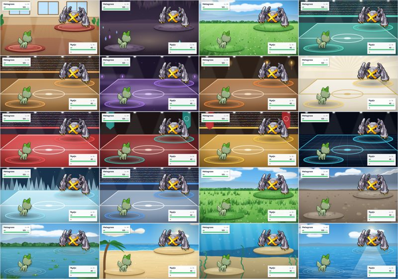
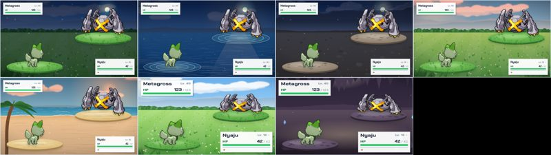
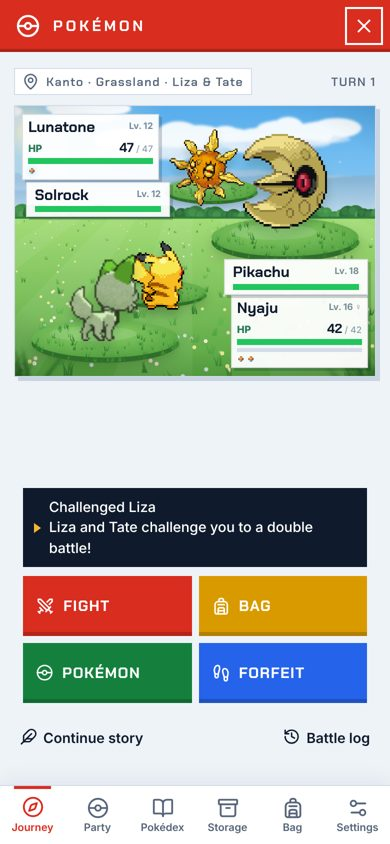
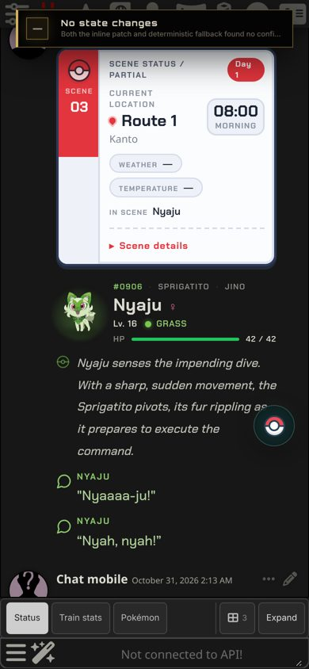
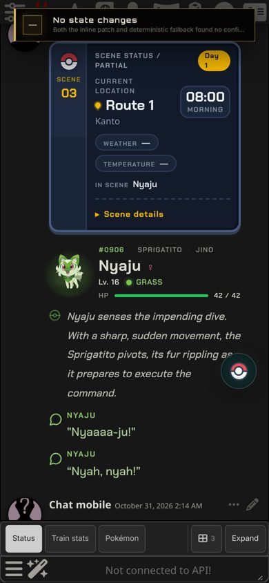
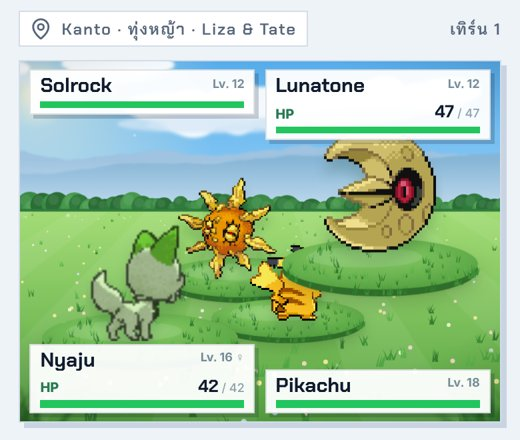
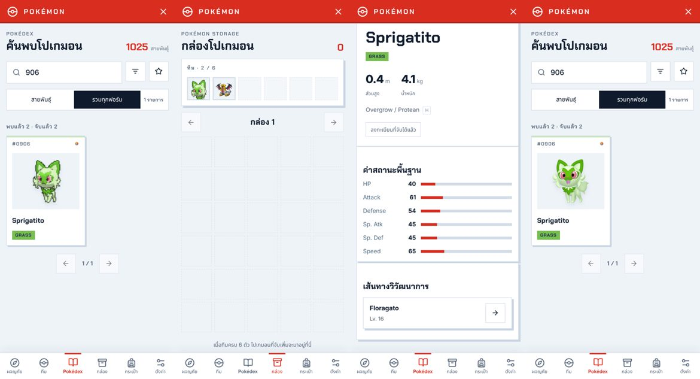
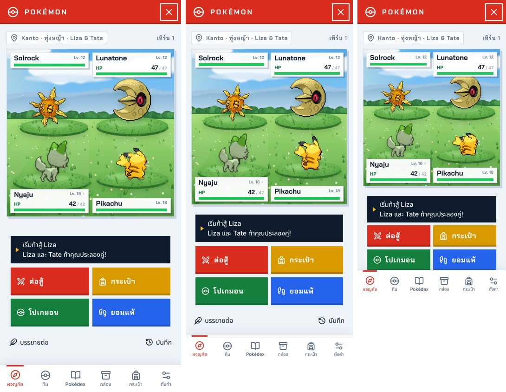

# Pokémon 2.1.0 / RoleForge 0.94.0

## สนามต่อสู้วาดใหม่

- **ครบทั้ง 20 สนาม:** ทุ่งหญ้า หญ้าสูง ชายหาด ทะเล บ่อน้ำ ใต้น้ำ ภูเขา ถ้ำ ในอาคาร และสนามในร่มทุกแบบ (ยิม หัวหน้ายิม Elite Four ทั้งสี่ แชมเปียน และ Link) มีภาพฉากและฐานยืนใหม่ที่วาดขึ้นสำหรับ Add-on นี้ ไฟล์เป็น SVG จึงคมทุกขนาดจอ และสร้างซ้ำได้ด้วย `tools/build-pokemon-scenes.py`
- **แสงตามเวลาในโรล:** สนามกลางแจ้งเปลี่ยนตามนาฬิกาของเรื่อง รุ่งเช้า กลางวัน พลบค่ำ และกลางคืน (มีดวงจันทร์ ดาว และหิ่งห้อย) ฐานยืนและโปเกมอนมืดลงตามแสง
- **บรรยากาศ:** มุมกล้องเลื่อนช้า ๆ ละอองเกสรในทุ่งหญ้า ประกายแดดบนทรายและน้ำ ฟองอากาศใต้น้ำ ฝุ่นในถ้ำและอาคาร หิมะในห้องของ Lorelei หมอกในห้องของ Agatha
- **สภาพอากาศในศึก:** ฝน หิมะ/ลูกเห็บ พายุทราย และแดดจัด แสดงบนสนาม
- ปิดการเคลื่อนไหวได้ด้วย Animations หรือ Reduce Motion ของเครื่อง
- **กลับไปใช้ภาพเดิม:** Settings → World & journey → Field art → Classic FireRed

## อื่น ๆ

- **ศึกคู่:** โปเกมอนตัวที่สองของทั้งสองฝั่งมีฐานยืนของตัวเอง
- **การ์ดข้อมูลฉากในธีม Pokémon League:** การ์ดโค้งแบบกล่องข้อความในเกม แถบซ้ายเป็น Poké Ball พร้อมเลขฉาก เวลาในกรอบมน สภาพอากาศและผู้ที่อยู่ในฉากเป็นชิป Day ใช้สีขาว-แดง Night ใช้สีกรมท่า-ทอง
- **จับโปเกมอน:** ไม่มีข้อความขึ้นบนสนามแล้ว บอลส่ายแล้วคลิกหรือแตกออกเหมือนเดิม
- แก้การทดสอบ window-settings ให้นับปุ่ม Vibration ที่มีเฉพาะเบราว์เซอร์ที่สั่นได้

## ภาพตัวอย่าง (SillyTavern 1.19)

| | | |
|---|---|---|
|  |  |  |

## การตรวจสอบ

- `npm test` (2,240 รายการ), `npm run check` และ `git diff --check` ผ่าน
- SillyTavern 1.19 จริง: pokemon-dossier, pokemon-facing, pokemon-window-settings, pokemon-chat และ chat-appearance ผ่าน
- ถ่ายภาพสนามครบ 20 แบบในการต่อสู้จริงบนเดสก์ท็อป กลางคืน พลบค่ำ รุ่งเช้า และบนมือถือ ไม่มี error ในหน้าเว็บ

## 0.94.1 / Pokémon 2.1.1

- **ศึกคู่:** โปเกมอนตัวที่สองของแต่ละฝั่งเป็นสนามยืนเต็มรูปแบบ ยืนกลางฐานบนพื้น ไม่ลอย บนมือถือแถบ HP ทั้งสี่เรียงขอบบนและล่าง อยู่ฝั่งเดียวกับโปเกมอนของตัวเอง
- **แสงในฉาก:** เอาลำแสงที่ส่องลง (แสงสะท้อนบนทะเล แสงจากหน้าต่าง แสงไฟสนาม และแสงใต้น้ำ) ออก
- **มือถือ:** ภาพโปเกมอนไม่ล้นกรอบใน Pokédex และกล่องทุกชุดภาพ แถว "สายพันธุ์ / รวมทุกฟอร์ม / จำนวน" ไม่ทับกัน หน้ารายละเอียดมีระยะขอบในส่วนค่าสถานะและวิวัฒนาการ

 

## 0.94.2 / Pokémon 2.1.2

- **ศึกคู่บนมือถือ:** สนามเป็นสี่เหลี่ยมจัตุรัส (สูงกว่า 4:3 ไม่ใช้ 16:9 เพราะบนจอโทรศัพท์ 16:9 จะเตี้ยลงอีก) แถบ HP ทั้งสี่อยู่ขอบบนและล่าง และวาดจากหลังมาหน้า ตัวที่อยู่ใกล้กว่าจึงไม่ถูกฐานของฝั่งตรงข้ามบัง (เช่น หัวของ Pikachu ไม่หายใต้ฐานของ Lunatone แล้ว)
- จอเตี้ยมาก (สูงไม่เกิน 700px) กล่องข้อความและปุ่มคำสั่งในศึกคู่กระชับขึ้น

