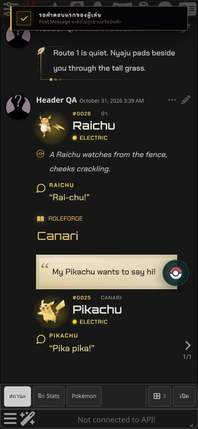
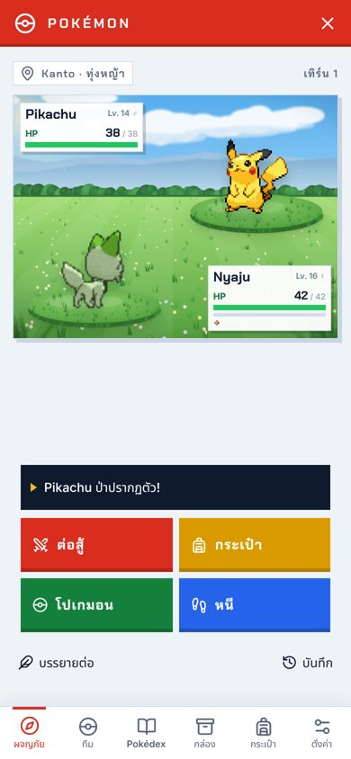

# Pokémon 2.2.0 / RoleForge 0.95.0

## ผู้เล่นกำหนดโปเกมอนที่เจอ (ตัวเลือก)

Settings → Experience → **ผู้เล่นกำหนดโปเกมอนที่เจอ** ค่าเริ่มต้นปิด

- เมื่อเปิดแล้ว ถ้าข้อความของคุณบรรยายว่าโปเกมอนป่าตัวหนึ่ง*ปรากฏตอนนี้* เช่น "ทันใดนั้น Pikachu ก็กระโดดออกมาตรงหน้า!" หรือ "A wild Gible appears in front of me" ศึกจะเริ่มกับตัวนั้นทันทีโดยไม่ต้องรอ AI เลเวลเท่ากับคู่หูตัวนำ − 2 เหมือน Explore
- ชื่อภาษาอังกฤษในข้อความเริ่มศึกได้ทันที ถ้าสะกดเป็นภาษาไทย (ไรจู, ไรย์จู …) ระบบบอก AI ว่าการตั้งค่านี้เปิดอยู่ ให้ AI ทำให้ตัวนั้นปรากฏและส่งข้อมูลการเจอมา
- ไม่นับ: ความอยาก ("อยากหาไรจู") แผนหรือเงื่อนไข ("ถ้าเจอ…") ประโยคปฏิเสธ และคำพูดในเครื่องหมายคำพูด
- โปเกมอนในตำนานยังต้องผ่านภารกิจหายาก

## โปเกมอนทุกตัวใช้ Pokémon Header

- ชื่อสายพันธุ์ (Pikachu), รูปแบบมีเจ้าของ (Canari's Pikachu, Pikachu (Canari)) และรหัส `pokemon:…` ใช้ Pokémon Header เสมอ และมาก่อน NPC ที่ชื่อเดียวกัน
- ถ้าในแชทมีตัวนั้นอยู่ (ในทีม ในศึก หรือทีมประจำของ NPC) จะใช้ข้อมูลของตัวนั้น ถ้าไม่มี จะแสดง Header ของสายพันธุ์ (ภาพ ธาตุ ไม่มีเลเวลและ HP)
- ระบบ NPC จะไม่สร้างโปเกมอนเป็น NPC อีก ทั้งจากบทพูดและจากข้อมูลที่ AI ส่งมา
- ชื่อเล่นยังให้ NPC มนุษย์ที่ชื่อซ้ำมาก่อนเหมือนเดิม

## การ์ด Pokémon RPG 1.3.1

- คลัง NPC ไม่มีโปเกมอนเลย เหลือ 2,857 รายการ (ตรวจด้วยการถอดคลังจากไฟล์ PNG จริง และมีชุดทดสอบตรวจทุกครั้ง)
- เอาออกเพิ่ม 7 รายการที่แหล่งข้อมูลจัดเป็นตัวละคร เช่น Arceus, Zygarde, Calyrex, Necrozma, Koraidon, Miraidon และ Ditto
- เอาโปเกมอนในตำนานของ Gazette และ Alfmorii ออกจาก NPC ด้วย รายละเอียดยังอยู่ครบในคลังข้อมูลโลก และในข้อมูลของ Gazette และ Alfmorii
- นำเข้าการ์ดใหม่เพื่อรับคลังที่อัปเดต แชทเก่าที่นำเข้าคลังเดิมไว้ยังได้ Pokémon Header เพราะ Pokémon มาก่อน NPC แล้ว

 
