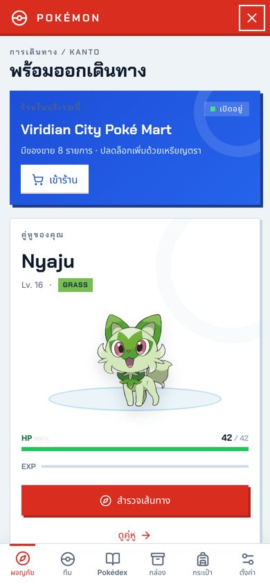
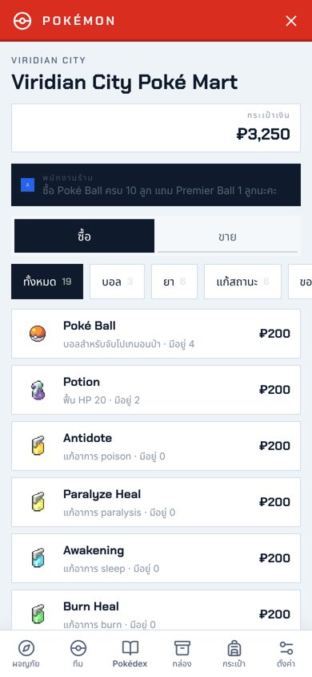
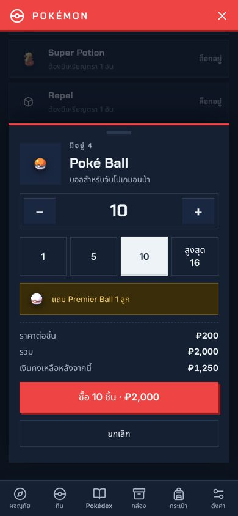
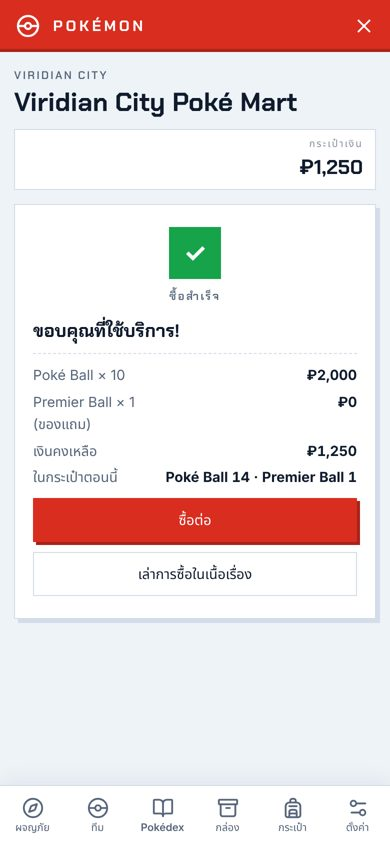
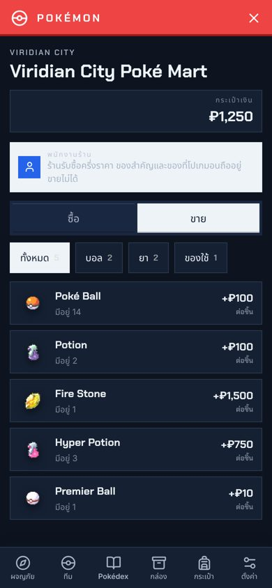
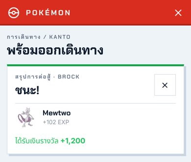

# Pokémon 2.3.0 / RoleForge 0.96.0

## ร้านค้า Poké Mart

ซื้อและขายไอเทมโปเกมอนในหน้าต่าง Pokémon เอง ของเข้ากระเป๋า Pokémon ทันที เงินตัดจากกระเป๋าเงิน RoleForge (₽) ในการบันทึกครั้งเดียวกัน

**เข้าร้านได้ที่ไหน**

- เมืองและหมู่บ้าน (ชื่อสถานที่มี City, Town, Village, เมือง, หมู่บ้าน, Poké Mart, ร้าน, ห้าง ฯลฯ) มี Poké Mart เสมอ การ์ดสีน้ำเงิน "ร้านในบริเวณนี้" ขึ้นที่หน้า Journey และมีปุ่ม Poké Mart ใน dock ข้างช่องพิมพ์
- เมื่อเนื้อเรื่องพาเข้าร้าน AI ส่งเหตุการณ์ `shop` มาเปิดร้านนั้นได้ ร้านเฉพาะทาง (เช่น ห้างสรรพสินค้า ร้านหิน) ขายได้เฉพาะไอเทมที่มีในแคตตาล็อกและมีราคา ไม่เกิน 24 รายการ
- เส้นทาง ถ้ำ และป่าไม่มีร้าน ร้านปิดระหว่างการต่อสู้ และร้านจากเนื้อเรื่องปิดเมื่อย้ายสถานที่หรือเริ่มการต่อสู้
- ตั้งค่า "เปิดร้านได้ทุกที่" (Sandbox) ขายของทุกชิ้นที่มีราคาในทุกสถานที่ ค่าเริ่มต้นปิด

**ราคาและของในร้าน**

- ราคามาจากข้อมูลไอเทมของ PokeAPI เสมอ AI ตั้งราคาไม่ได้ ปรับทั้งร้านได้ ×0.5, ×1, ×1.5, ×2 ในตั้งค่า
- Poké Mart ปลดล็อกของตามจำนวนเหรียญตรา: 0 อัน (Poké Ball, Potion, ยาแก้สถานะ, Escape Rope) · 1 อัน (Great Ball, Super Potion, Repel) · 3 อัน (Revive, Full Heal, Super Repel) · 5 อัน (Ultra Ball, Hyper Potion, Max Repel) · 7 อัน (Max Potion) · 8 อัน (Full Restore)
- ซื้อ Poké Ball ครบทุก 10 ลูก แถม Premier Ball 1 ลูก (ปิดได้)
- ขายคืนได้ครึ่งราคา ของสำคัญและของที่โปเกมอนถืออยู่ขายไม่ได้ (แสดงเหตุผลในรายการ)

**วิธีซื้อ**

1. แตะไอเทม แผ่นเลือกจำนวนจะเลื่อนขึ้นมา ปุ่ม 1 / 5 / 10 / สูงสุด คำนวณจากเงินที่มีและที่ว่างในกระเป๋า
2. ดูราคารวมและเงินคงเหลือหลังซื้อ แล้วกดปุ่มซื้อ ซึ่งบอกยอดที่จะจ่ายจริง
3. ใบเสร็จขึ้นหลังบันทึกแชทสำเร็จแล้วเท่านั้น ปุ่ม "เล่าการซื้อในเนื้อเรื่อง" ใส่บรรทัดสั้น ๆ ลงช่องพิมพ์ให้แก้ก่อนส่งได้ (ไม่ส่งเอง)
4. การขายแสดงผลเป็นแถบสั้นด้านล่าง ขายต่อหลายชิ้นได้เร็ว

**ความปลอดภัยของเงินและของ**

- ทุกการซื้อขายเป็นเหตุการณ์ใน journal ของ Pokémon และบรรทัดในสมุดบัญชีเงินของ RoleForge ที่ใช้รหัสเดียวกัน บันทึกพร้อมกันในคำขอเดียว ถ้าบันทึกล้มเหลว ไม่มีการหักเงินและไม่มีของเพิ่ม
- ธุรกรรมผูกกับข้อความ AI ล่าสุด: swipe หรือย้อนข้อความนั้น ของและเงินย้อนพร้อมกัน การแก้ไขข้อความไม่ทำให้การซื้อหาย
- AI จะไม่ทำให้การซื้อเกิดขึ้นเองในเนื้อเรื่อง ถ้าคุณพิมพ์ว่าอยากซื้อ AI บรรยายฉากในร้าน แล้วคุณกดซื้อในหน้าต่าง

## เงินรางวัลจากเทรนเนอร์

- ชนะเทรนเนอร์ได้เงิน = เลเวลสูงสุดในทีมคู่แข่ง × 40 · หัวหน้ายิม × 100 · Elite Four และแชมป์ × 200 ในศึกคู่ได้จากทั้งสองคน
- AI ระบุ `"class":"gym-leader"|"elite-four"|"champion"` ได้เมื่อเนื้อเรื่องบอกตำแหน่งนั้นจริง หัวหน้ายิมจากเนื้อเรื่องให้เหรียญตราเมื่อชนะครั้งแรก (ศึกคู่ของหัวหน้ายิมให้ 1 อัน)
- เงินเข้ากระเป๋าพร้อมการบันทึกการกระทำที่ทำให้ชนะ และแสดงในการ์ดสรุปการต่อสู้และบันทึกการเดินทาง
- "แพ้แล้วเสียเงิน" (ค่าเริ่มต้นปิด): เสียครึ่งหนึ่งของเงินที่จะได้ถ้าชนะ ไม่เกินเงินที่มี

## ตั้งค่า

Settings → **ร้านค้าและเงินรางวัล**: เปิด/ปิดร้านค้า เงินรางวัล แพ้แล้วเสียเงิน ของแถม Premier Ball การขาย ร้าน Sandbox และราคาสินค้า

การ์ดที่ไม่มีสกุล Poké Dollar ใช้หน่วยเงินที่เล็กที่สุดของการ์ดแทน (1 ₽ = 1 หน่วย)

  
  
