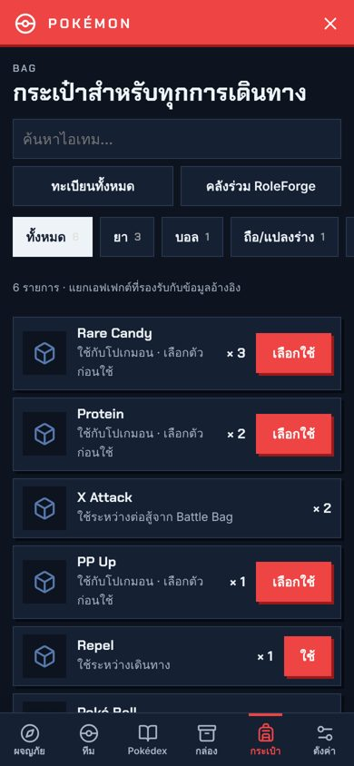
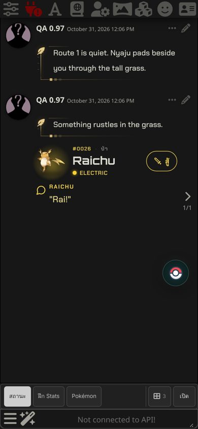
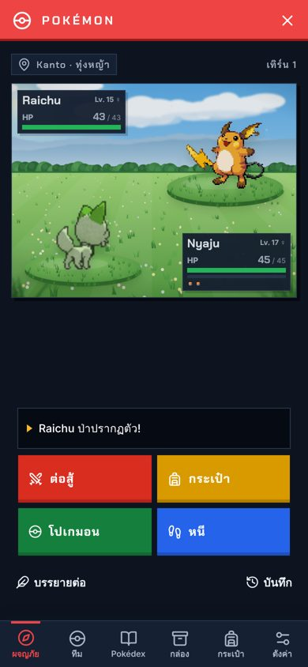
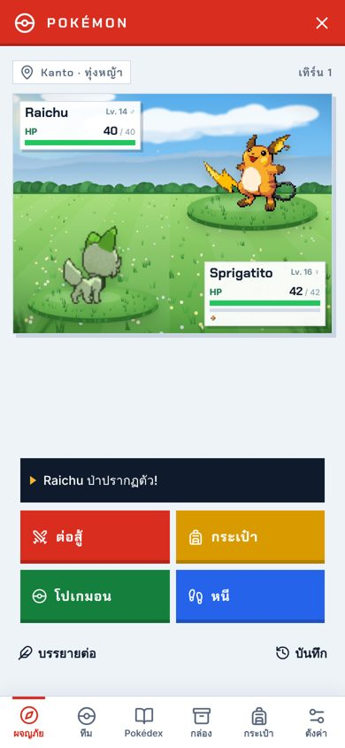
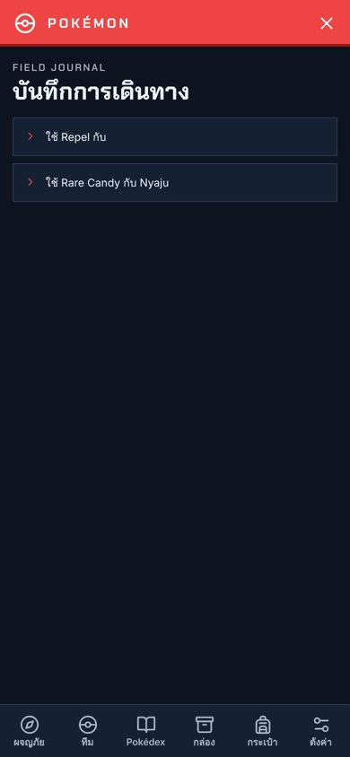
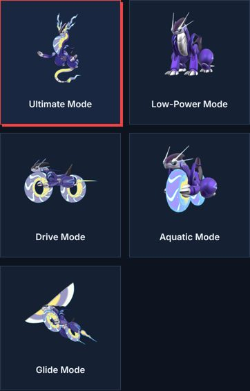

# Pokémon 2.4.0 / RoleForge 0.97.0

## ไอเทมใช้งานได้จริง

ไอเทมที่ในเกมใช้กับโปเกมอนหรือใช้ระหว่างเดินทางได้ ตอนนี้มีผลจริง กด **เลือกใช้** หรือ **ใช้** ในหน้า Bag หรือใช้จาก Battle Bag ระหว่างต่อสู้

- **เติบโต (เลือกตัวก่อนใช้):** Rare Candy (+1 เลเวล), EXP Candy XS–XL, วิตามิน (HP Up, Protein, Iron, Calcium, Zinc, Carbos +10 EV), ขนนก (+1 EV), เบอร์รี่ลด EV (Pomeg, Kelpsy, Qualot, Hondew, Grepa, Tamato −10 EV), PP Up / PP Max, Mint ทุกชนิด (เปลี่ยนผลของนิสัยต่อสเตตัส), Ability Capsule, Ability Patch, Bottle Cap / Gold Bottle Cap (ตั้งแต่ Lv. 50), Tera Shard 50 ชิ้นเปลี่ยน Tera Type
- **ระหว่างต่อสู้:** X Attack / Defense / Sp. Atk / Sp. Def / Speed / Accuracy (+2 ขั้น), Dire Hit, Poké Doll / Fluffy Tail / Poké Toy (หนีจากโปเกมอนป่าได้แน่นอน) ใช้แล้วคู่แข่งได้ตาเล่น
- **ระหว่างเดินทาง:** Repel / Super Repel / Max Repel (โปเกมอนป่าที่อ่อนกว่าตัวนำทีมไม่เข้าใกล้ 3 / 5 / 8 ข้อความของ AI ไม่กันเมื่อคุณเลือกสู้เอง), Escape Rope (บันทึกให้ AI เล่าการออกจากสถานที่), Honey (ล่อโปเกมอนป่าทันที)
- **ฟอสซิล:** Helix, Dome, Old Amber, Root, Claw, Skull, Armor, Cover, Plume, Jaw, Sail ฟื้นเป็นโปเกมอน Lv. 20 ได้เมื่ออยู่ที่ห้องแล็บหรือพิพิธภัณฑ์ในเนื้อเรื่อง
- **ยาเพิ่ม:** Fresh Water, Soda Pop, Lemonade, Moomoo Milk, Berry Juice, Energy Powder / Root, Heal Powder, Revival Herb, Max Honey, Sacred Ash (ฟื้นทุกตัวในทีม), Blue Flute และขนมแก้สถานะประจำเมือง
- ไอเทมสำคัญ วัตถุดิบ จดหมาย และของสะสม ไม่มีผลในการต่อสู้ตามแบบเกม ขายที่ร้านได้ถ้ามีราคา
- ไอเทมถูกหักเมื่อมีผลจริงเท่านั้น โปเกมอนจากแชตเก่ามากที่ใช้สเตตัสแบบคลาสสิกใช้ไอเทมเพิ่ม EV/IV ไม่ได้ ระบบจะบอกเหตุผล

## โปเกมอนในทีมอยู่ในบอลจนกว่าจะปล่อย

- คู่หูตัวแรกเดินข้างคุณตั้งแต่เริ่ม ตัวอื่นในทีมอยู่ในบอลจนกว่าคุณจะกด **Send out** หรือบรรยายว่าปล่อยออกมา
- ข้อมูลที่ส่งให้ AI ระบุตัวที่อยู่ในบอลชัดเจน (`inBall`) และไม่ให้รหัส header ของตัวนั้น AI จึงไม่ควรให้ตัวที่อยู่ในบอลออกมาเดินหรือพูดเอง
- เปลี่ยนตัวนำทีมแล้ว ตัวที่เดินตามเปลี่ยนตามด้วย

## เจอโปเกมอนแล้วหน้าต่างต่อสู้เปิดเอง

- ศึกที่เริ่มจากข้อความของคุณ (Player-chosen encounters) เปิดหน้าต่างต่อสู้ทันที ไม่ต้องกดเข้าไปเช็กเอง
- ชื่อภาษาไทย: ถ้าคุณบรรยายว่าโปเกมอนโผล่มา (เช่น "ไรจูกระโดดออกมา") แต่ระบบอ่านชื่อไม่ออก และ AI ตอบกลับโดยมี Pokémon Header ของโปเกมอนป่าตัวเดียวโดยไม่ส่งข้อมูลการเจอ ระบบเริ่มศึกกับตัวนั้นให้
- คำว่า "ไม่" ทั่วไป เช่น "ไม่ทันตั้งตัว…" ไม่ถูกนับเป็นประโยคปฏิเสธอีกแล้ว ยังไม่นับ: ไม่ได้ ไม่มี ไม่เจอ ไม่พบ ไม่ใช่ และความอยากหรือแผน

## ปุ่มสู้ใน Pokémon Header

Header ของโปเกมอนป่าในแชตมีปุ่ม **สู้** ใช้เมื่อเนื้อเรื่องเจอโปเกมอนแต่ศึกไม่เริ่มเอง ตัวที่เคยพบใช้เลเวลเดิม ตัวที่มีแค่ชื่อสายพันธุ์ใช้เลเวลตัวนำทีม − 2 โปเกมอนในตำนานยังต้องผ่านภารกิจ

## เหลือธีม Kinetic ธีมเดียว

- ลบธีม Original และ Aperture ออก ค่าที่เคยบันทึกไว้เปิดเป็น Kinetic เลือกโหมดสีอัตโนมัติ/สว่าง/มืดได้เหมือนเดิม
- โหมดมืด: การ์ดร่างใน Pokédex อ่านชื่อได้ชัด และบันทึกการเดินทางไม่มีแถบขาวคั่นแถวแล้ว

  
  
