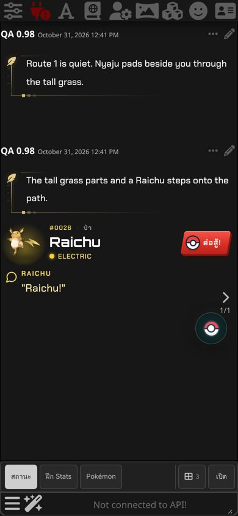
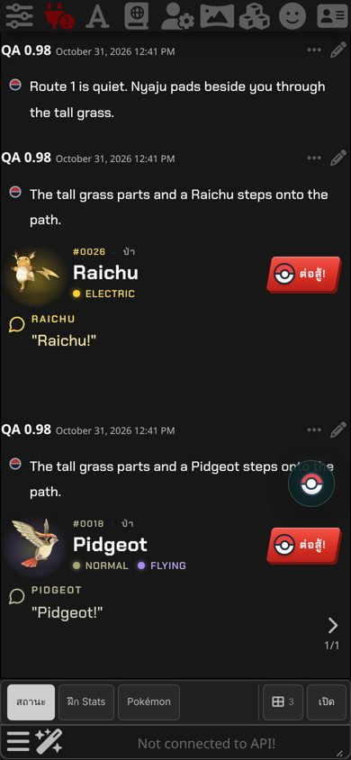
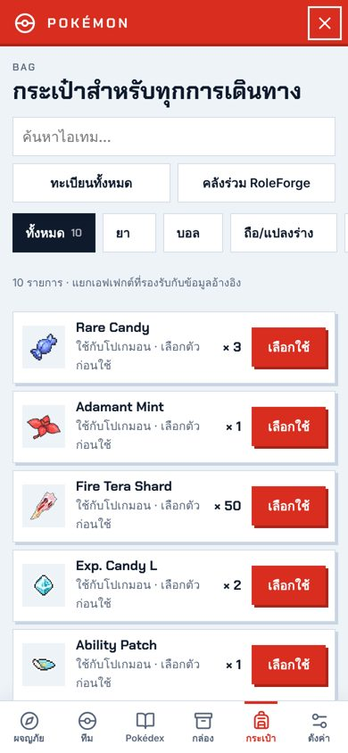
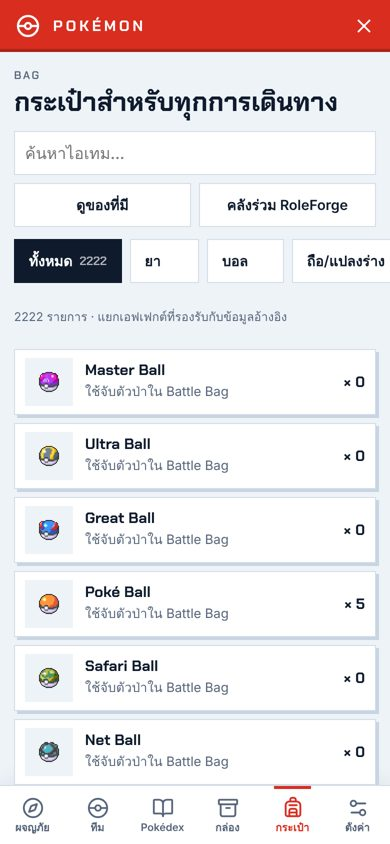

# Pokémon 2.4.1 / RoleForge 0.97.1

## รูปไอเทมครบทุกชิ้น

- ไอเทมทั้ง 2,223 ชิ้นในแคตตาล็อกมีรูปจากเกมแล้ว ทั้งในกระเป๋า หน้าทะเบียนทั้งหมด ร้านค้า และ Battle Bag ไม่มีไอคอนกล่องแทนรูปอีก
- รูปมาจากคลังภาพ PokeAPI/sprites ที่ตรึง commit ไว้ ตัดขอบว่างแล้วรวมเป็นไฟล์เดียว (`assets/items/atlas.webp` ประมาณ 1.25 MB) โหลดครั้งเดียวต่อการเปิด ภาพพิกเซลขยายแบบคม ภาพความละเอียดสูงย่อแบบนุ่ม
- 59 รูปเดิมของบอล ยา และหินวิวัฒนาการยังใช้ไฟล์เดิม

## ปุ่มต่อสู้ใหม่ใน Pokémon Header

- ปุ่มเป็นแผ่นสีแดงเฉียงแบบเมนู FIGHT ในเกม มี Poké Ball นำหน้า ตัวอักษร Chakra Petch และเงาแข็งสีแดงเข้ม
- วางเมาส์แล้ว Poké Ball ส่ายและมีแสงวิ่งผ่าน กดแล้วปุ่มยุบลง ปิดอนิเมชันอัตโนมัติเมื่อเครื่องตั้งให้ลดการเคลื่อนไหว
- ทดสอบกับธีม Dark Lite และพรีเซ็ต Gemini Omega 2.6 ที่ผู้ใช้เล่นจริง ทั้งธีมแชตปกติและ Pokémon League · Night

   
