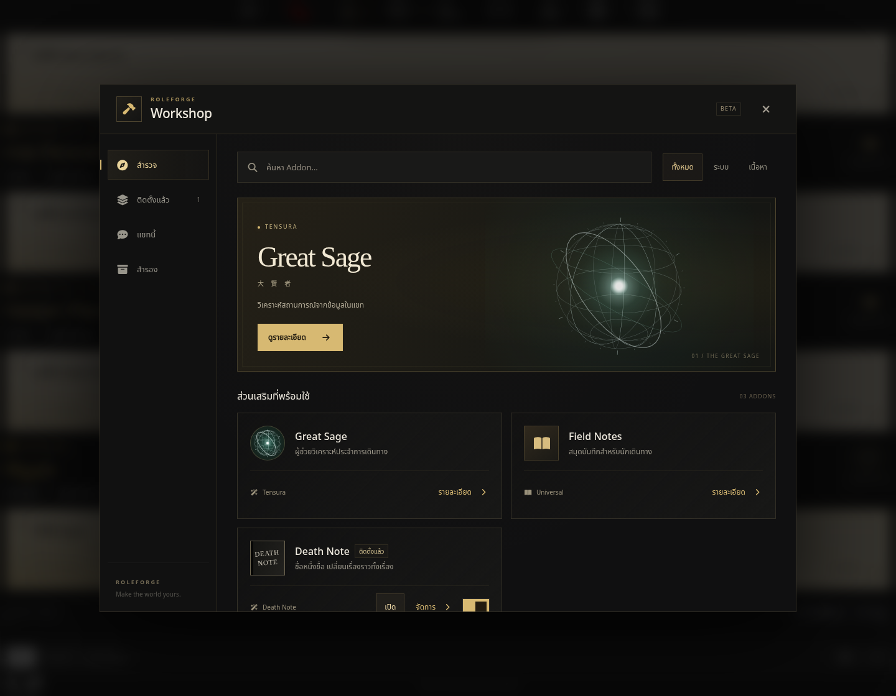
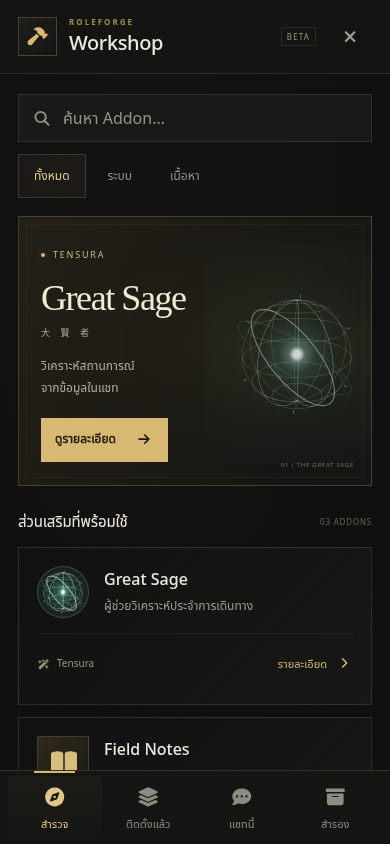
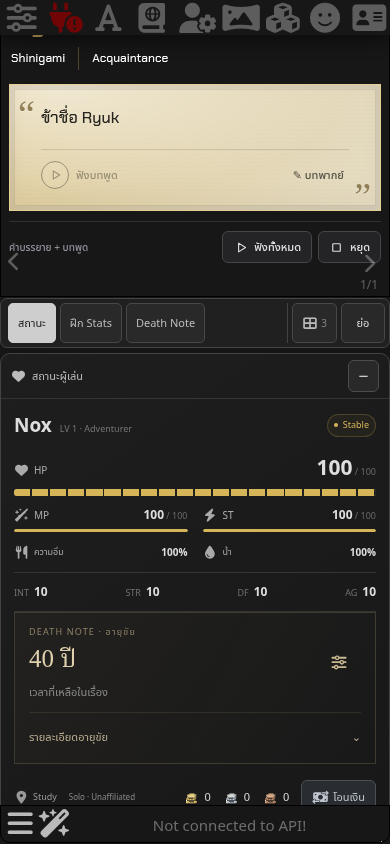
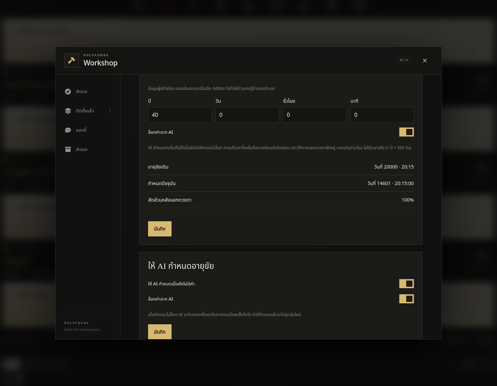

# RoleForge 0.84.0 — Workshop และอายุขัยผู้เล่น

Workshop ใช้กรอบเหลี่ยม โทนถ่านดำ/ทองของ RoleForge บนคอมและมือถือ หน้าจอมือถือยังเปิดเต็มจอ เอฟเฟกต์ลูกแก้ว Great Sage และวงแสดงกิจกรรมยังคงรูปร่างตามหน้าที่เดิม

## ตั้งค่า Death Note

เข้า **Workshop → ติดตั้งแล้ว หรือ แชทนี้ → Death Note → ตั้งค่า**

- **ทางลัดเปิดสมุด** อยู่ตอนต้นของหน้าตั้งค่า มีสวิตช์ปุ่มลอยและคืนตำแหน่ง ค่าเปิด/ปิดเดิมยังอยู่แยกตามแชท ซ่อนปุ่มลอยแล้วยังเปิดจาก Chatbar/Wand Menu ได้
- **อายุขัยของคุณ** กรอกเวลาที่เหลือเป็นปี วัน ชั่วโมง นาที แล้วบันทึก เป็นการแก้ค่าปัจจุบันโดยผู้เล่นโดยตรง โดยเก็บอายุขัยเดิมและประวัติการแลกดวงตาไว้
- **ให้ AI กำหนดอายุขัย** เปิดการกำหนดครั้งแรกและปลดล็อก เพื่อให้ AI ใส่ค่าในการตอบโรลครั้งถัดไป หากมีค่าอยู่แล้วจะไม่สุ่มหรือเขียนทับ สามารถล็อกไม่ให้ AI กำหนดได้

การตั้งค่าเหล่านี้ไม่ส่งข้อความฝั่ง User และไม่เรียกโมเดลเอง การกำหนดโดย AI ต้องอาศัยคำตอบที่มีข้อมูลตาม protocol หากโมเดลไม่ส่งข้อมูลจะยังขึ้น “ยังไม่กำหนด” และตั้งเองได้เสมอ

## Status เหนือ Chatbar

แสดง **เวลาที่เหลือ** เป็นหลัก กด “รายละเอียดอายุขัย” เพื่อดูอายุขัยเดิม กำหนดปัจจุบัน และสัดส่วนหลังแลกดวงตา ปุ่มปรับค่าที่มุมขวาเปิดหน้าตั้งค่า Addon โดยตรง ใช้ได้กับ Status ทั้งสามแบบ

เวลาลดตาม `worldClock` ในโรล ไม่เดินตามนาฬิกาจริง ใช้ 365 วันในเรื่องต่อปี การแลกดวงตาลดครึ่งหนึ่งของเวลาที่เหลือ ณ ตอนแลก และไม่คืนค่าเมื่อสละสิทธิ์สมุดหรือปิด Addon หากค่าพื้นฐานยังไม่ถูกกำหนดตอนแลก ระบบเก็บเวลาแลกไว้เพื่อคำนวณเมื่อมีค่าเริ่มต้นภายหลัง

ค่าที่ตั้งเป็นข้อมูลเกม ไม่ใช่คำทำนายจริงหรือการยืนยันข้อมูลต้นฉบับ ถ้าการ์ดเดิมระบุเฉพาะวันที่ปฏิทินโดยไม่มีวันในเรื่อง ระบบเก็บวันเดิมไว้และให้ผู้เล่นกำหนดเวลาที่เหลือเอง แทนการเดาจุดเริ่มปฏิทิน

## ความรู้ในโรลและการเก็บข้อมูล

- Status เป็นข้อมูลผู้สร้างโรล การเห็นค่าบน UI ไม่ทำให้ตัวละครรู้ค่าของตัวเอง
- NPC ที่มีดวงตาต้องเห็นใบหน้าผู้เล่นก่อนจึงอ่านได้ การมีสมุดอย่างเดียวไม่เพิ่มพลังดวงตา
- มนุษย์ที่มีดวงตาอ่านอายุขัยของเจ้าของสิทธิ์สมุดไม่ได้ ส่วนยมทูตอ่านได้ ผู้เล่นที่ไม่ได้เป็นเจ้าของสิทธิ์จึงถูก NPC ที่มีดวงตาอ่านได้ตามเงื่อนไข
- ข้อมูลสายตาของ NPC เป็นความรู้เฉพาะตัว ไม่เปิดชื่อจริงหรือความรู้นั้นให้ผู้เล่นโดยอัตโนมัติ
- ปิด Death Note แล้วแถวอายุขัยและ prompt เฉพาะระบบจะหายไป แต่ข้อมูลในแชทยังอยู่ เปิดกลับมาใช้ค่าเดิมได้
- ค่ากับการตั้งค่าถูกบันทึกใน journal ของข้อความ AI ใช้ swipe/ขอบเขตข้อความร่วมกับระบบเดิม จึงย้อนตามจุดสร้าง Branch ได้
- อายุขัยเหลือศูนย์ไม่สั่งลด HP หรือฆ่าตัวละครอัตโนมัติ ผลในเรื่องยังต้องเป็นไปตามโรล

## ภาพและการทดสอบ

ดู [ภาพคอมและมือถือทั้งหมด](previews/workshop-lifespan-v0840/index.html)









ทดสอบกับ SillyTavern 1.19.0 ผ่านการนำเข้าการ์ด เปิดแชท ตั้งค่า โหลดใหม่ ปิด/เปิด Addon และสร้าง Branch จริง ชุดทดสอบ AI ใช้คำตอบ SSE ที่ควบคุมได้ผ่านระบบ Generate ของ SillyTavern ไม่ได้เรียกโมเดลหรือบริการเสียงภายนอก มือถือทดสอบแบบ viewport/touch emulation ไม่ใช่ iPhone เครื่องจริง

ผลตรวจ: ชุดอัตโนมัติ **1,721 ผ่าน / 0 ไม่ผ่าน**, syntax ผ่าน, อายุขัย/Workshop ผ่าน Chromium และ WebKit ทั้งคอมและมือถือ, Death Note เดิมผ่านทั้ง 5 ธีม และ Status ทั้ง 3 รูปแบบ รวมการลากด้วย touch, การโหลดใหม่, Branch, การกดตั้งค่าทันทีหลัง AI กำหนดค่า และปิดสมุดระหว่าง Continue

ดู [รายงานรวม](previews/workshop-lifespan-v0840/validation.json) และรายงานย่อยในโฟลเดอร์ภาพ

```sh
npm test
npm run check
npm run test:workshop-lifespan:real
npm run test:death-note:actors:real
npm run test:death-note:controls:real
npm run test:death-note:close:real
```

เปลี่ยน `ST_REAL_URL` ได้สำหรับ SillyTavern บน localhost ใช้ `DN_ARTIFACTS` แยกตำแหน่งรายงาน/ภาพ และ `DN_BROWSER=webkit` สำหรับ WebKit ในชุด lifespan/controls

หลังอัปเดต RoleForge เป็น 0.84.0 ให้โหลดหน้า SillyTavern ใหม่ ไม่ต้องถอนหรือติดตั้ง Death Note Addon ใหม่
