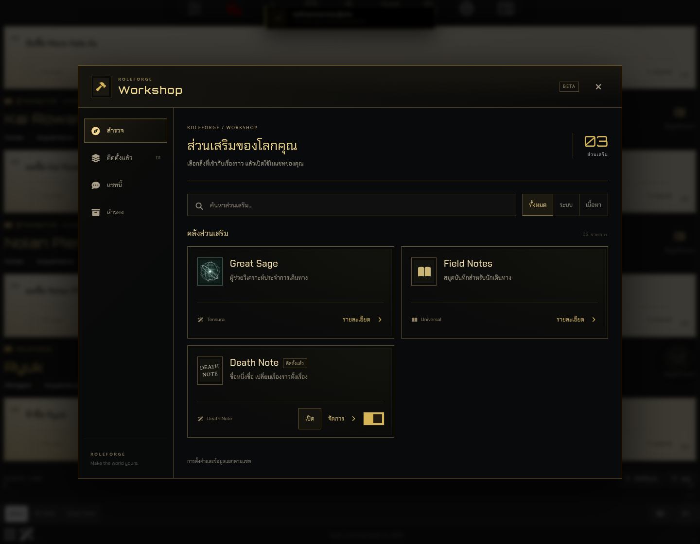
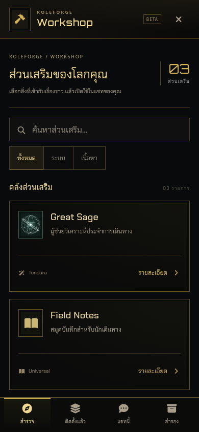

# RoleForge 0.84.1 — Workshop และความเร็ว Death Note

## หน้าตา Workshop

ปรับสีเป็นดำและทองหม่น ฟอนต์ Chakra Petch/Orbitron และกรอบเส้นแบบเดียวกับ NPC Management ของ RoleForge ใช้มุมเหลี่ยมตรงทั้งหมด รวมกรอบหน้าต่าง การ์ด ไอคอน ปุ่ม ช่องกรอก และสวิตช์

หน้าแรกเป็นคลัง Addon โดยตรง เอาแบนเนอร์ Great Sage ขนาดใหญ่ออกเพื่อให้แต่ละ Addon หาเจอง่ายขึ้น แสดงสถานะติดตั้งและปุ่มเปิด/จัดการบนการ์ด มือถือยังเปิดเต็มจอ มีเมนูด้านล่างคงที่และเนื้อหาเลื่อนแยกจากเมนู

[ภาพคอมและมือถือ](previews/workshop-performance-v0841/index.html)





## สาเหตุที่ Death Note หน่วง

ในการเปิดสมุดครั้งหนึ่ง โค้ดเดิมอ่าน host context ถึง 127 ครั้งและสร้างสถานะสมุดจากประวัติแชทซ้ำ 25 ครั้ง หน้าสิทธิ์และหน้ารายชื่อก็ประมวลผลข้อมูลเดิมซ้ำขณะสร้างแต่ละส่วนของ UI รวมถึงเตรียม NPC และตรวจซ่อม journal ใหม่แม้ข้อมูลไม่เปลี่ยน

แก้ดังนี้:

- อ่าน context สถานะสมุด และ ledger ครั้งเดียวต่อการ render แล้วใช้ข้อมูลชุดเดียวกันในส่วนย่อย
- แยกการตรวจรหัสแชท/บริบทออกจากการโหลดสถานะเต็ม
- เตรียมข้อมูลและตรวจ journal ซ้ำเมื่อข้อมูลที่เกี่ยวข้องเปลี่ยนเท่านั้น
- เปิดสมุดโดยไม่วาดแผงและสร้าง editor ซ้ำในขั้น refresh ก่อนเปิด
- ตรวจการเปลี่ยนข้อความ swipe metadata สมุด inventory และ NPC โดยไม่ serialize ข้อความแชททั้งชุดเป็นสำเนาอีกชุดหนึ่ง
- ข้อมูลสำหรับ render ใช้เฉพาะงาน synchronous ไม่เก็บข้าม await หรือเหตุการณ์ถัดไป การแก้ข้อความ เปลี่ยนคำตอบ โหลดใหม่ และ Branch จึงอ่านข้อมูลปัจจุบัน

การจัดเก็บสมุด ประวัติชื่อที่เขียน การตรวจชื่อจริง/ใบหน้า สิทธิ์สมุด ดวงตา และอายุขัยใช้ข้อมูลเดิม ไม่ต้องถอนหรือติดตั้ง Addon ซ้ำ

## ผลวัดความเร็ว

| ขนาดหน้าจอ | ก่อนปรับ | หลังปรับ | อัตราเร็วขึ้น |
| --- | ---: | ---: | ---: |
| คอม | 1260.4 ms | 118.7 ms | 10.6 เท่า |
| มือถือจำลอง | 1247.3 ms | 82 ms | 15.2 เท่า |

ในการเปิดสมุด ทั้งสองขนาดอ่าน host context จาก **127 → 2 ครั้ง** และสร้างสถานะจากประวัติ **25 → 2 รอบ** การสลับหน้ารายชื่อ/กฎ/สิทธิ์/เขียนใช้ 1 รอบต่อการวาดหน้า

## วิธีวัดและการทดสอบ

วัดผ่าน SillyTavern 1.19.0 จริง แชททดสอบ 121 ข้อความ เปิดหน้าเขียน 3 ครั้งหลังเตรียมข้อมูล และวัดการสลับหน้ารายชื่อ/กฎ/สิทธิ์/เขียนด้วย Playwright ตัวเลข JavaScript แยกจากเวลารอเฟรมวาด ไม่มีการเรียกโมเดลใน benchmark

ค่าที่วัดเป็นผลบนเครื่องทดสอบ ไม่ใช่การรับประกันความเร็วบนโทรศัพท์ทุกเครื่อง การทดสอบมือถือใช้ viewport และ touch emulation ไม่ใช่เครื่อง iPhone จริง ส่วนคำตอบ AI ในการทดสอบการทำงานใช้ SSE ที่ควบคุมได้ผ่าน Generate ของ SillyTavern

ผลตรวจ: **1,725 ผ่าน / 0 ไม่ผ่าน** และ syntax ผ่าน หน้าตา Workshop ผ่าน Chromium และ WebKit ทั้งคอม/มือถือ ทดสอบขนาด 320–1440px แนวนอนและหน้าจอเตี้ย ควบคู่กับการเขียน/ลากข้อความ การบันทึก โหลดใหม่ การสลับคำตอบ การปิดสมุดขณะรอ AI ชื่อภาษาไทย สิทธิ์สมุด ดวงตาทั้ง 5 ธีม และอายุขัย/Branch

ดู [รายงานรวมและตัวเลขก่อน–หลัง](previews/workshop-performance-v0841/validation.json) พร้อมรายงานย่อยในโฟลเดอร์เดียวกัน

```sh
npm test
npm run check
ST_REAL_URL=http://127.0.0.1:18186 DN_PERF_ASSERT=1 npm run test:workshop-performance:real
ST_REAL_URL=http://127.0.0.1:18186 npm run test:workshop-square:real
ST_REAL_URL=http://127.0.0.1:18186 npm run test:workshop:layout:real
npm run test:death-note:actors:real
npm run test:death-note:controls:real
ST_REAL_URL=http://127.0.0.1:18186 npm run test:death-note:close:real
npm run test:death-note:ownership:real
npm run test:workshop-lifespan:real
```

กำหนด `DN_ARTIFACTS` เพื่อแยกภาพและรายงานของแต่ละชุด สำหรับ square ใช้ `DN_BROWSER=webkit` ได้ รายงาน layout ใช้ `WORKSHOP_ARTIFACTS`

หลังอัปเดต RoleForge เป็น 0.84.1 ให้โหลดหน้า SillyTavern ใหม่เพื่อโหลด JavaScript/CSS รุ่นนี้
